  
  
  

 

<!-- projects:start -->
<table>
<tr>
<td width="33%" valign="top">

 <code>01</code>
 <b><a href="https://www.broslunas.com/es/projects/6ad35a898edc6949d0e2f356" target="_blank" rel="noopener">ejecuta.tech</a></b>
 Playground online para compilar y ejecutar código en el navegador: C++, Python, TypeScript, JavaScript, HTML y Bash.
</td>
<td width="33%" valign="top">

 <code>02</code>
 <b><a href="https://www.broslunas.com/es/projects/6ad35a898edc6949d0e2f357" target="_blank" rel="noopener">PagaLaGasofa</a></b>
 Calcula el coste de un viaje, repártelo entre los pasajeros y encuentra la gasolinera más barata de España.
</td>
<td width="33%" valign="top">

 <code>03</code>
 <b><a href="https://www.broslunas.com/es/projects/6ad33dfd8ade78068f7eed9e" target="_blank" rel="noopener">Veredillas FM</a></b>
 Plataforma web de podcast y radio escolar del IES Las Veredillas: episodios por temporadas, radio en directo, blog, ranking de oyentes y cr…
</td>
</tr>
</table>
<!-- projects:end -->

  

<table>
  <tr>
    <td width="33%" valign="top">
      <code>&lt; CORE &gt;</code>
       <b>HTML · CSS · JavaScript · TypeScript</b>
    </td>
    <td width="33%" valign="top">
      <code>&lt; FRAMEWORKS &gt;</code>
       <b>React · Next.js · Astro · Node.js</b>
    </td>
    <td width="34%" valign="top">
      <code>&lt; DISEÑO Y FLUJO &gt;</code>
       <b>Figma · Git · GitHub · UI/UX · Performance</b>
    </td>
  </tr>
</table>

  

<!-- blog:start -->
<table>
<tr>
<td width="18%" valign="top"><code>17.10.2026</code></td>
<td valign="top"><b><a href="https://www.broslunas.com/es/blog/ejecuta-tech-y-pagalagasofa" target="_blank" rel="noopener">Dos proyectos nuevos: ejecuta.tech y PagaLaGasofa</a></b> Un playground para ejecutar código en el navegador y una app para repartir el coste de los viajes. Qué hacen y qué me llevo de construirlos.</td>
</tr>
<tr>
<td width="18%" valign="top"><code>22.06.2026</code></td>
<td valign="top"><b><a href="https://www.broslunas.com/es/blog/lanzamiento-divvy" target="_blank" rel="noopener">Lanzamiento de Divvy: Gastos Compartidos y Cuentas Claras</a></b> Presento mi nuevo proyecto personal, Divvy. Una web app y PWA inteligente diseñada para dividir gastos y simplificar deudas en grupo de for…</td>
</tr>
<tr>
<td width="18%" valign="top"><code>31.01.2026</code></td>
<td valign="top"><b><a href="https://www.broslunas.com/es/blog/lanzamiento-veredillasfm" target="_blank" rel="noopener">Veredillas FM: Reinventando la radio de tu insti</a></b> Te presento la nueva web de Veredillas FM. Mucho más que escuchar podcasts: chat en directo, noticias y una comunidad para todos.</td>
</tr>
<tr>
<td width="18%" valign="top"><code>21.12.2025</code></td>
<td valign="top"><b><a href="https://www.broslunas.com/es/blog/seguridad-ia-formulario-contacto" target="_blank" rel="noopener">IA Guardiana: Protección Inteligente en mi Formulario de Contacto con n8n</a></b> He actualizado mi formulario de contacto integrando n8n y un sistema de filtrado por IA que analiza cada mensaje para bloquear el spam de f…</td>
</tr>
</table>
<!-- blog:end -->

  

<!-- certs:start -->
<table>
<tr>
<td width="33%" valign="top">

 <b>Desarrollo Web con IA</b>
 <code>Midu.dev · 21.05.2026</code>
</td>
<td width="33%" valign="top">

 <b>Introducción a la IA para Developers</b>
 <code>Midu.dev · 20.05.2026</code>
</td>
<td width="33%" valign="top">

 <b>Google Cybersecurity</b>
 <code>Coursera · 19.09.2025</code>
</td>
</tr>
<tr>
<td width="33%" valign="top">

 <b>Figma Desde 0</b>
 <code>Midu.dev · 16.07.2025</code>
</td>
<td width="33%" valign="top">

 <b>CSS Desde 0</b>
 <code>Midu.dev · 12.07.2025</code>
</td>
<td width="33%" valign="top">

 <b>HTML desde 0</b>
 <code>Midu.dev · 11.07.2025</code>
</td>
</tr>
</table>
<!-- certs:end -->

 

<picture>
  <source media="(prefers-color-scheme: dark)" srcset="https://raw.githubusercontent.com/broslunas/broslunas/pacman-output/bomberman-contribution-graph-dark.svg">
  <source media="(prefers-color-scheme: light)" srcset="https://raw.githubusercontent.com/broslunas/broslunas/pacman-output/bomberman-contribution-graph.svg">
  
</picture>

<table>
  <tr>
    <td width="50%" align="center" valign="top">
      
    </td>
    <td width="50%" align="center" valign="top">
      
    </td>
  </tr>
  <tr>
    <td colspan="2" align="center">
      
    </td>
  </tr>
</table>

  

  
  
  

